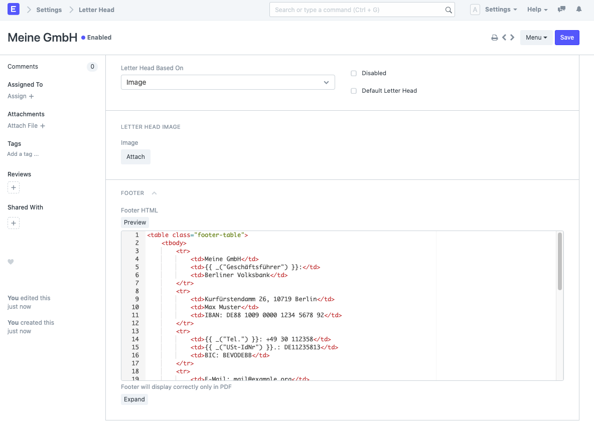
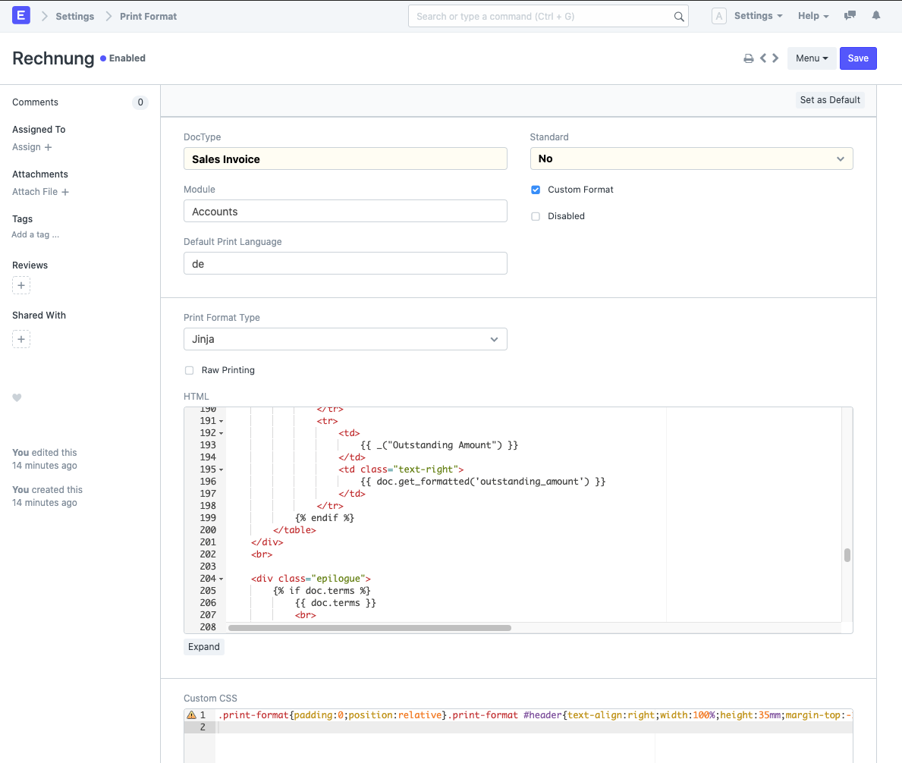

# ERPNext print formats (DIN 5008)

> Originally developed for ERPNext `version-13`, also tested against `version-15`. Other versions may need minor tweaks.

* `letter_head.jinja` — HTML and CSS for the footer.
* `print_style/print_style.scss` — shared CSS for all print formats.
* `print_format/*.jinja` — one Jinja template per DocType.

## How print formats are delivered

> **Important change:** print formats now belong **inside the customer's Frappe app**, rather than being pushed onto a running site by a REST script.

Previously the print formats lived outside the customer app and `update.py` pushed them over the REST API. The flaw in that design: the print formats are then missing from the app. App code is versioned and deployed — the print formats were not, they only existed in each site's database.

So this repo is now primarily a **template to inject into a Frappe app**:

| | [`frappe-pf-init`](#migrating-into-a-frappe-app-recommended) (recommended) | [`update.py`](#legacy-updatepy-rest-sync) (legacy) |
|---|---|---|
| Target | a Frappe app's source tree | a running site, over REST |
| Versioned | with the app, in git | no |
| Rollout | `bench migrate` / `bench install-app` | manual script run |
| Editable in Desk | yes, but overwritten on `bench migrate` | yes |
| Needs Sass | no (`libsass` bundled) | yes (`npm`/`brew`) |

Use `frappe-pf-init` for new projects. `update.py` stays useful for ad-hoc tweaks against a running site.

## Migrating into a Frappe app (recommended)

`frappe-pf-init` scaffolds a `print_format_sources/` folder into a target Frappe app from any conforming print-format repo (this one or a fork). Run it from inside the print-format repo and pass the target app's repo root:

```bash
uvx --from git+https://github.com/alyf-de/erpnext_druckformate frappe-pf-init /path/to/your_frappe_app
```

Flags: `--source PATH` (source repo, default: current directory), `--dry-run`, `--force` (overwrite an existing `print_format_sources/`).

### What the source repo must look like

```
<source-repo>/
    config.ini             # [Section] DocType=... TemplateFile=print_format/foo.jinja
    print_format/*.jinja   # templates referenced by config.ini
    print_style/*.scss     # exactly one shared stylesheet
```

`[Section]` titles become **Print Format** names. Keys are treated as follows:

| Key | Treatment |
|---|---|
| `DocType` | required; becomes the Print Format's `doc_type` |
| `TemplateFile` | required; the `print_format/` prefix is stripped (templates are copied flat) |
| `ScssFile`, `IsStandard` | ignored — the migrator compiles the SCSS itself and always writes `standard = "No"` |
| `CssFile` | rejected; every format shares the one compiled stylesheet |
| anything else | passed through as a **Print Format** field override (e.g. `module`, `pdf_generator`) |

Unknown field overrides are rejected at sync time, so a typo fails loudly instead of being silently ignored.

### What lands in the target app

```
<app>/<app>/print_format_sources/
    __init__.py
    config.py              # generated from config.ini
    print_formats.py       # builder + sync_print_formats()
    print_formats.css      # compiled from print_style/*.scss (expanded, so it stays readable in Desk)
    *.jinja                # copied from print_format/
    .synced                # source repo URL + commit + timestamp
```

`sync_print_formats` is added to both `after_migrate` and `after_install` in the app's `hooks.py`, so `bench migrate` and `bench install-app` each import the formats via `import_doc`. Existing hooks are preserved: a string value is expanded to a list, an existing list is appended to, and entries already present are skipped. `install.py` is never touched, so apps without one work too.

Formats are imported with `standard = "No"`, matching the legacy `IsStandard = 0`. With `"Yes"`, Frappe exports each format to disk on every `developer_mode` save — into the module folder of the app that owns the module, which resolves to ERPNext's, since no `module` is set. `"No"` keeps `print_format_sources/` the only copy.

### After running

1. **Custom Jinja helpers.** If your templates use helpers like `split_quill`, expose them via your app's `jinja` hook.
2. **Trim** any formats you don't want to ship from `config.py`.
3. **Run** `bench --site <site> migrate` and check the formats in Desk. Edit the `.jinja` files rather than Desk — a migrate overwrites Desk edits.

The migrator is one-shot. Re-running needs `--force`, which overwrites in place without deleting files the source repo has since dropped. Pull later updates with a manual `git diff` between the source's `print_format/` and your `print_format_sources/`.

---

## Legacy: `update.py` (REST sync)

`update.py` updates the print formats on a running ERPNext site over REST, without copy + paste.

### Dependencies

[Sass](https://sass-lang.com/install) is required to compile the SCSS (`npm install -g sass` or `brew install sass/sass/sass`); `frappe-pf-init` bundles `libsass` and does not need it. To produce `print_style/print_style.css`:

```
sass --style=compressed print_style/print_style.scss print_style/print_style.css
```

### Setup

1. Create and activate a virtual environment:

    ```
    python3.10 -m venv env
    source env/bin/activate   # Windows: env\Scripts\activate
    ```

2. Install dependencies: `pip install -r requirements.txt`
3. Copy `.env.example` to `.env` and set `BASE_URL`, `USER` and `PASSWORD`.

### Usage

With the virtual environment active, run `python update.py`. See `python update.py --help` for more options.

VSCode can push formats automatically via the [File Watcher](https://marketplace.visualstudio.com/items?itemName=appulate.filewatcher) extension: changing one template syncs that template, changing the SCSS syncs all of them, since they share the CSS.

### Windows compatibility

Sass compilation from Python may fail on Windows. A possible fix:

```diff
def get_css(input_path: Path) -> str:
    return run(
-        ["sass", "--style=compressed", input_path], check=True, capture_output=True
+        ["sass", "--style=compressed", input_path], check=True, capture_output=True, shell=True
    ).stdout.decode()
```

## Manual setup in ERPNext

1. Create a **Letter Head**: copy `letter_head.jinja` into "Footer HTML", and add a letterhead as image or HTML.

    

2. Open **Company**, set that **Letter Head** as "Default Letter Head", and add a company address — it appears as the sender.

3. Create an **Address Template** per target country. One for your own country plus a default for all others is usually enough.

    **Germany**:

    ```jinja
    {{ address_line1 }}<br>
    {{ address_line2 }}<br>
    {{ pincode }} {{ city }}<br>
    ```

    **All Countries** (enable _Is Default_):

    ```jinja
    {{ address_line1 }}<br>
    {{ address_line2 }}<br>
    {{ pincode }} {{ city }}<br>
    {{ state }}<br>
    {{ country | upper }}
    ```

4. Create a **Print Format** per DocType, pasting the template from `print_format/` and the CSS from `print_style/print_style.css`.

    > [`frappe-pf-init`](#migrating-into-a-frappe-app-recommended) does this step for you; copying by hand is only needed for the legacy route.

    

5. Set the "Default Print Format" per DocType via **Customize Form**.

## Development

### Print style

Keep every CSS block scoped to `.print-format`, or the styles leak into the whole system.

### Jinja

All print formats are [Jinja templates](https://jinja.palletsprojects.com/en/2.11.x/templates/) with the document exposed as `doc`: `{{ doc.due_date }}` is the due date, `{{ doc.name }}` the invoice number. Use `{{ doc.get_formatted('due_date') }}` for localised output (24.12.2020 instead of 2020-12-24, € 10,00 instead of 10.0).

Some Python and Frappe functions are available too — e.g. ``, then `{{ company.website }}`. Frappe also provides variables such as `footer` and `print_settings`:

- [Frappe Jinja API](https://docs.frappe.io/framework/user/en/api/jinja)
- [safe_exec.py](https://github.com/frappe/frappe/blob/version-15/frappe/utils/safe_exec.py)
- [printview.py](https://github.com/frappe/frappe/blob/4c6b58da2699189e6992707254f7a95f5c7df64a/frappe/www/printview.py#L148-L157)
- [standard.css](https://github.com/frappe/frappe/blob/8b7c976f680b2aac1b33cf45720beaf653ccdad0/frappe/templates/styles/standard.css) and [standard.html](https://github.com/frappe/frappe/blob/8b7c976f680b2aac1b33cf45720beaf653ccdad0/frappe/templates/print_formats/standard.html) — the standard print format, useful for reference and debugging

### Translations

All documents should work in multiple languages, German and English in particular. Short terms use `_("Translate me!")`, based on the English term. Longer text uses a conditional:

```jinja

    <p>Sehr geehrte Damen und Herren,<p>

    <p>Dear Sir or Madam,<p>

```

## Support

Need help adapting the print formats? Contact us — details on [our website](https://alyf.de).
